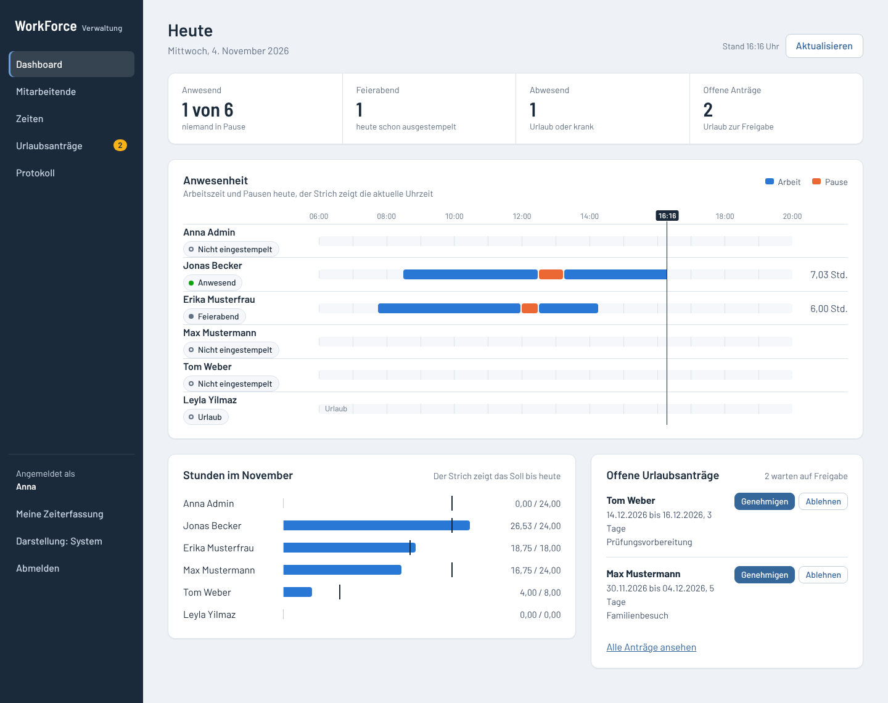
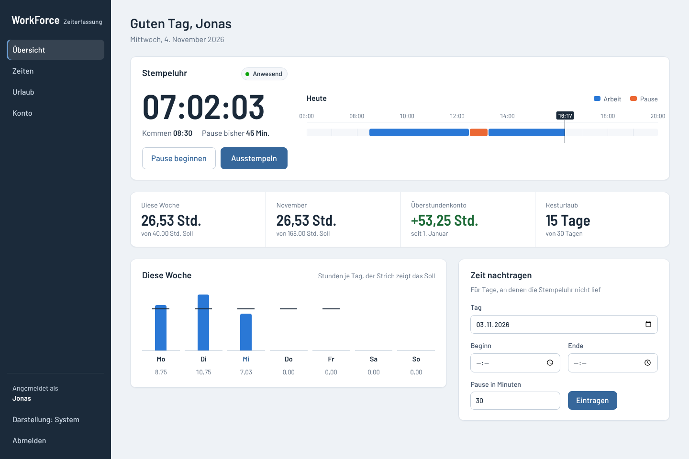
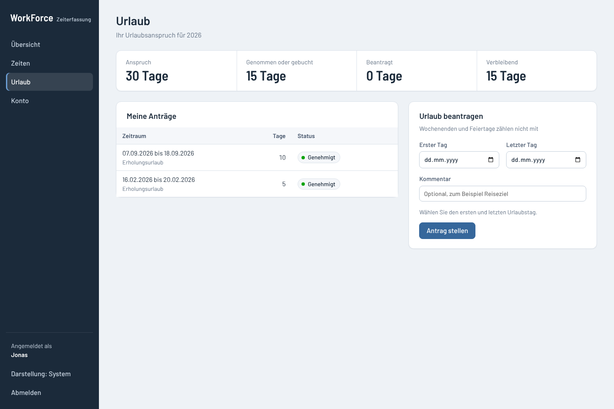
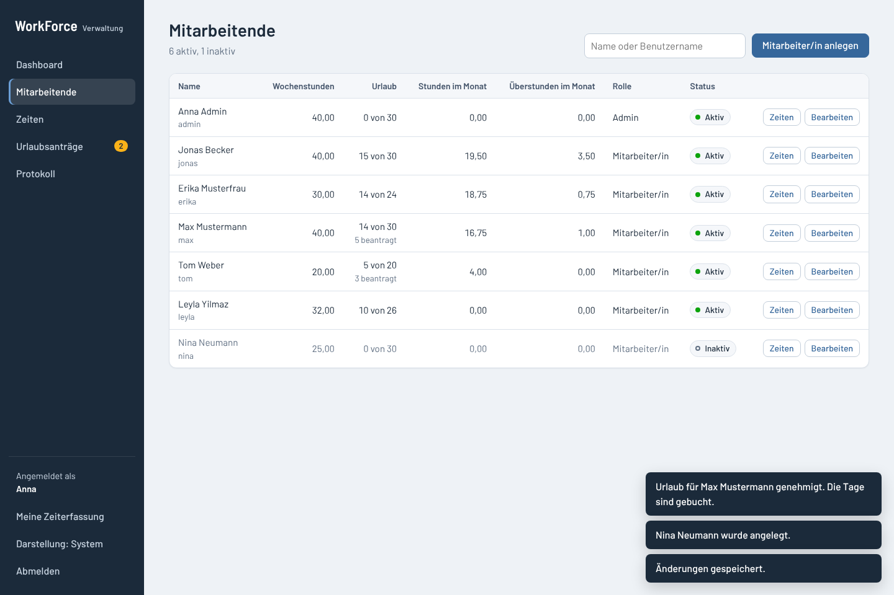
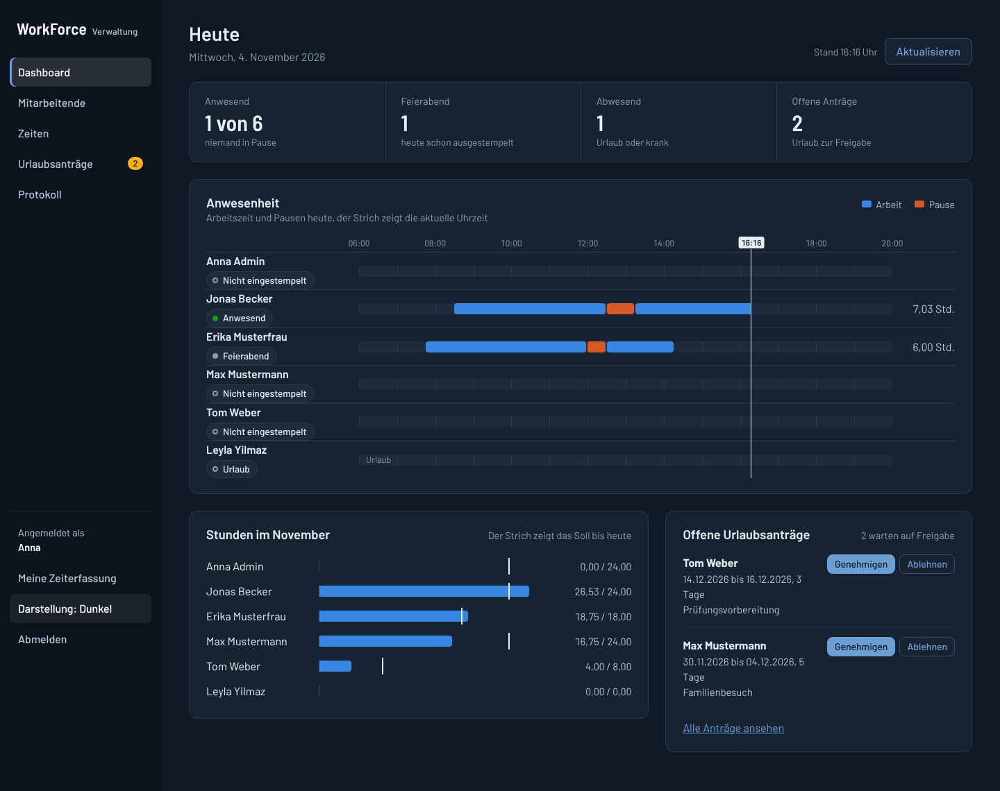
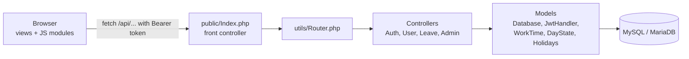

# WorkForce: Zeiterfassung (Abschlussprojekt)

[](https://github.com/SawGamer/AbschlussProjekt/actions/workflows/tests.yml)

A time-tracking web app for small teams, built as my final project ("Abschlussprojekt"). It has two panels:

- **Employees** clock in and out, take breaks, correct their hours, request vacation, and export their month.
- **Admins** see who is working right now, manage accounts, correct anyone's hours, decide on vacation requests, and read an activity log.

The back end is plain PHP with no framework: a hand-written router, an MVC structure, and JWT authentication. The front end is plain JavaScript modules, HTML, and CSS, with no build step and no front-end libraries.

[Deutsche Kurzfassung](#kurzfassung-auf-deutsch)



| Employee overview | Vacation requests |
| --- | --- |
|  |  |
| **Employee management** | **Dark mode** |
|  |  |

## Features

### Employee panel

- **Stamp clock with breaks:** clock in, start and end breaks, clock out. The server records every time, so a reload or a second device shows the same state.
- **Today's timeline:** work and breaks as a bar along the day, with a marker for the current time.
- **Overview figures:** hours this week and this month against the target, the overtime account since 1 January, and remaining vacation.
- **Month and year tables:** edit start, end, break, day type, and comment. Each change is saved right away, and the server sends back the hours and overtime.
- **CSV export:** one month as a file that opens directly in German Excel.
- **Vacation requests:** pick the first and last day; the form counts the working days and checks the remaining balance.
- **Account:** change the password. Every other session is logged out.

### Admin panel

- **Attendance board:** every employee's day as a timeline, with status (present, on a break, finished, absent), refreshed every minute.
- **Monthly hours chart:** hours so far against the target to date, per person.
- **Employees:** search, create, edit, deactivate, and reset passwords. Deactivating or resetting logs the person out at once.
- **Times:** open any employee's month or year and correct it.
- **Vacation requests:** approve (books the working days as vacation), reject with a note, or cancel an approved request.
- **Activity log:** who changed which hours, accounts, and vacation, and when.

### Rules the app applies

- **Public holidays** are calculated for any year from the date of Easter (Baden-Württemberg).
- **Daily target** is the weekly contract hours divided by five, so part-time works.
- **Vacation, sick, and holiday days** are credited instead of counting as missing hours.
- **Worked hours and overtime** are always calculated on the server.

## How it works



1. The login form posts to `/api/login`. The server checks the bcrypt hash, signs a JWT, and redirects to the matching panel.
2. The panel collects the token once from `/api/authenticate` and sends it as a `Bearer` header with every call.
3. Every request checks the token against the database: a logout, a password change, a deactivation, or a role change takes effect immediately.
4. Employees can only reach their own data. Admins can reach everyone's, and their changes are logged.

| Folder | Contents |
| --- | --- |
| `public/` | Web root: `Index.php` (front controller with all routes), `router.php` (PHP's built-in server), `.htaccess` (Apache) |
| `public/views/` | The two panels (`user_view.php`, `admin_view.php`), login and logout pages, `styling.css` |
| `public/views/JS/` | Front-end modules: `ui.js` (toolkit), `timeline.js` (charts), the employee pages, the admin pages, the time tables |
| `Controllers/` | Request handling and validation: `AuthController`, `UserController`, `LeaveController`, `AdminController` |
| `Models/` | `Database` (queries), `JwtHandler`, `WorkTime` (targets and balances), `DayState` (clock state), `Holidays` |
| `utils/` | Router with path parameters, JSON helpers, HTTP errors |
| `Config/` | Database and JWT settings from environment variables |
| `database/` | `schema.sql` and `seed.php` with fictional demo data |
| `tests/` | Unit tests, API integration tests, browser tests |

### API

All errors come back as JSON, for example `{"error": "Forbidden"}`, with a matching status code (400, 401, 403, 404, 405, 409, or 422).

| Method | Path | Who | Purpose |
| --- | --- | --- | --- |
| POST | `/api/login` | everyone | Log in with the form fields `username` and `password` |
| GET | `/api/authenticate` | after login | Collect the token once (204 if none is waiting) |
| POST | `/api/logout` | signed in | Revoke every token of the caller |
| GET | `/api/user/today?id=` | employee or admin | Name, weekly hours, and today's clock state with breaks |
| GET | `/api/user/summary?id=` | employee or admin | Week, month, overtime account, vacation figures |
| POST | `/api/user/clock` | employee or admin | `{"id", "action"}` with `start`, `pause`, `resume`, or `stop` |
| GET | `/api/user/hours?id=&year=&month=` | employee or admin | One month's days, or twelve month totals with targets when `month` is left out |
| POST | `/api/user/hours` | employee or admin | Save one day: `{"id", "date", "start_time", "end_time", "pause", "type", "comment"}` |
| GET | `/api/user/export?id=&year=&month=` | employee or admin | The month as a CSV file |
| POST | `/api/user/password` | the employee | `{"id", "current_password", "new_password"}`; returns a fresh token |
| GET | `/api/user/leave?id=` | employee or admin | Vacation figures and the employee's requests |
| POST | `/api/user/leave` | employee or admin | Request vacation: `{"id", "start_date", "end_date", "comment"}` |
| POST | `/api/user/leave/{requestId}/cancel` | employee or admin | Withdraw a pending request |
| GET | `/api/admin/overview` | admin | Attendance board, month hours against target, open requests |
| GET | `/api/admin/employees` | admin | All employees with this month's hours and vacation figures |
| POST | `/api/admin/employees` | admin | Create an employee |
| PATCH | `/api/admin/employees/{id}` | admin | Change fields, deactivate, or set a new password |
| GET | `/api/admin/leave?status=pending\|decided` | admin | Vacation requests |
| POST | `/api/admin/leave/{requestId}/approve`, `/reject`, `/cancel` | admin | Decide on a request, optionally with `{"note"}` |
| GET | `/api/admin/audit` | admin | The last 200 log entries |

## Run it locally

You need PHP 8.1 or newer with the `mysqli` extension, and MySQL 8 or MariaDB 10.5 or newer.

1. Create the database and the demo accounts:

   ```bash
   mysql -u root < database/schema.sql
   ```

2. Add fictional sample data: hours since 1 January, vacation, open requests, and people at work today:

   ```bash
   php database/seed.php
   ```

3. Start PHP's built-in server:

   ```bash
   php -S localhost:8000 -t public public/router.php
   ```

4. Open http://localhost:8000 and log in with a demo account:

   | User | Password | Role |
   | --- | --- | --- |
   | `admin` | `admin1234` | Admin |
   | `max` | `demo1234` | Employee, 40 hours per week |
   | `erika` | `demo1234` | Employee, 30 hours per week |
   | `jonas`, `leyla`, `tom` | `demo1234` | Employees, 40, 32 and 20 hours per week |

**XAMPP or another Apache setup:** copy the project into `htdocs` and open `http://localhost/<folder>/public/`. The `.htaccess` file in `public/` sends API requests to `Index.php`, so `mod_rewrite` must be enabled.

### Configuration

Settings are read from environment variables. The defaults fit a local XAMPP database.

| Variable | Default | Purpose |
| --- | --- | --- |
| `DB_HOST`, `DB_PORT` | `127.0.0.1`, `3306` | Database server |
| `DB_USER`, `DB_PASSWORD` | `root`, empty | Database login |
| `DB_NAME` | `workforce` | Database name |
| `JWT_SECRET` | a development value | Key for signing tokens. **Set your own value outside local development.** |
| `APP_TIMEZONE` | `Europe/Berlin` | Time zone for the clock and the activity log |
| `APP_DEBUG` | off | Set to `1` to show PHP errors |

## Tests

| Suite | Command | What it covers |
| --- | --- | --- |
| Unit | `php tests/run.php` | 47 checks: holidays, targets and balances, clock states, JWT (forged, expired, `alg: none`), router, CSV safety |
| API | `php tests/api.php` | 68 checks against a running server: permissions, clock state machine, vacation workflow, employee management, export, password change, logout |
| Browser | `node tests/e2e.js` | 38 checks in Chromium with Playwright: both panels, dialogs, dark mode, phone layout |

The API and browser tests change data, so seed again before each run. GitHub Actions runs all three suites on every push, against MySQL 8.

## Security

- Passwords are stored as bcrypt hashes. Every query uses prepared statements.
- Tokens are signed with HMAC-SHA256 and compared with `hash_equals`. Expiry, issuer, audience, and a per-user version number are checked, so tokens can be revoked.
- Every request is checked against the token and the database. Employees can only reach their own data.
- Error responses never contain SQL errors or request headers. Details go to the PHP error log.
- The interface writes data with `textContent`, never as HTML. The CSV export neutralises spreadsheet formulas.

## Known limitations

- Holidays follow Baden-Württemberg. Other states need their own list in `Models/Holidays.php` and `worktime.js`.
- The daily target assumes a five-day week. Vacation is booked in whole days.
- The app serves one company.
- Fonts load from Google Fonts. For offline installs, host them locally.

## Changes after the final project

The submitted version needed a database file that was not in the repository, so the project could not be run. Since then:

- **Setup:** database schema, fictional demo data, a router for PHP's built-in server, and environment-based configuration.
- **Security:**
  - Replaced MD5 password hashes with bcrypt.
  - Fixed the JWT handling.
  - Added token revocation.
  - Stopped sending request headers and password hashes to the browser.
- **Bugs fixed:**
  - The admin route never matched.
  - Breaks were saved in hours but read as minutes.
  - Clocking out did not calculate the day's hours.
  - The month table showed the wrong number of days.
  - The manual entry form posted to a route that did not exist.
  - The 2024 holidays were wrong.
- **New features:**
  - Breaks recorded on the server.
  - A full admin panel: attendance board, employee management, corrections, activity log.
  - Vacation requests with approval.
  - CSV export and password changes.
  - Part-time targets.
  - Dark mode.
- **Structure:**
  - The router became a small class with path parameters.
  - All working-time rules moved to the server.
  - The front end became ES modules with hash routing.
  - Tests were added on three levels.

## Kurzfassung auf Deutsch

WorkForce ist eine Zeiterfassung für kleine Teams und mein Abschlussprojekt.

- **Mitarbeitende:**
  - stempeln sich ein und aus und machen Pausen;
  - korrigieren ihre Zeiten in einer Monatstabelle;
  - beantragen Urlaub und exportieren ihren Monat als CSV.
- **Admins:**
  - sehen auf einer Anwesenheitstafel, wer gerade arbeitet;
  - verwalten Konten und korrigieren Zeiten;
  - entscheiden über Urlaubsanträge;
  - lesen im Protokoll nach, wer was geändert hat.
- **Technik:** PHP ohne Framework (eigener Router, MVC, JWT-Anmeldung), JavaScript-Module, HTML und CSS, MySQL oder MariaDB.
- **Regeln:**
  - Feiertage werden für jedes Jahr aus dem Osterdatum berechnet (Baden-Württemberg).
  - Das Tagessoll ergibt sich aus den Wochenstunden.
  - Urlaub und Krankheit werden gutgeschrieben.
- **Sicherheit:**
  - bcrypt-Passwörter, Prepared Statements und signierte Tokens, die beim Abmelden ungültig werden;
  - Berechnung der Stunden auf dem Server;
  - ein Protokoll aller Änderungen durch Admins.
- **Starten:**
  1. `mysql -u root < database/schema.sql`
  2. `php database/seed.php`
  3. `php -S localhost:8000 -t public public/router.php`
  4. Anmelden mit `admin` / `admin1234` oder `max` / `demo1234`.
- **Tests:** `php tests/run.php` (Unit), `php tests/api.php` (API), `node tests/e2e.js` (Browser).
