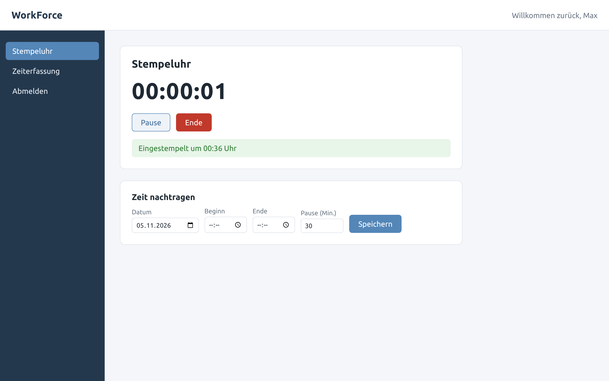
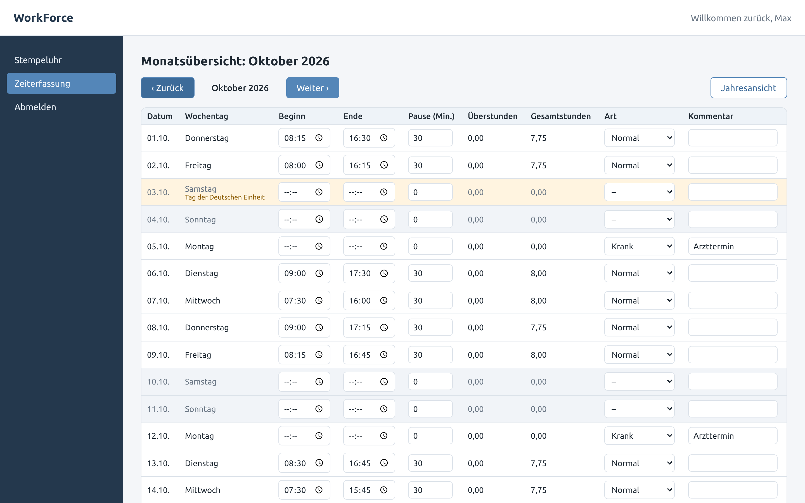
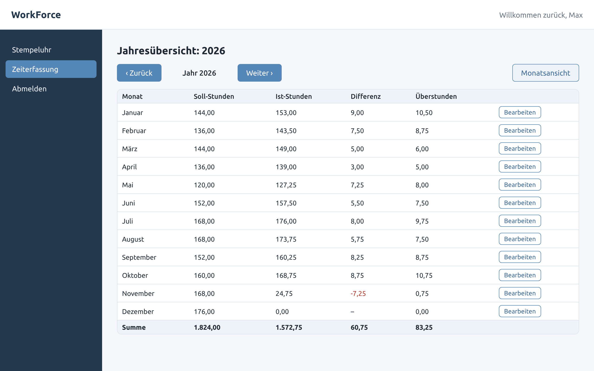
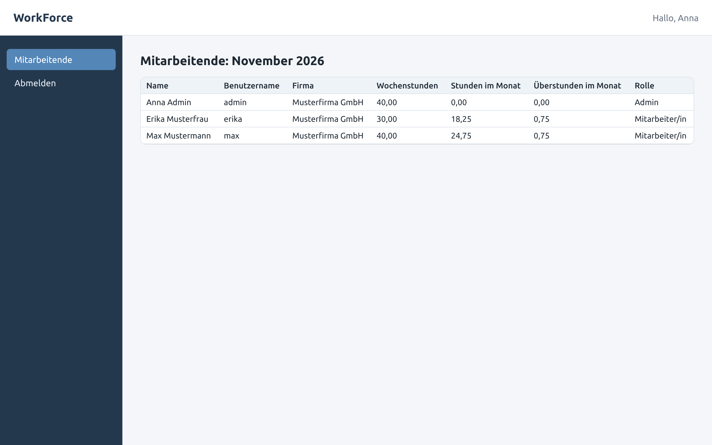
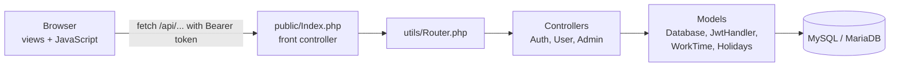

# WorkForce: Zeiterfassung (Abschlussprojekt)

[](https://github.com/SawGamer/AbschlussProjekt/actions/workflows/tests.yml)

A time-tracking web app for small teams, built as my final project ("Abschlussprojekt"). Employees clock in and out, correct their hours in a monthly table, and see a yearly balance. An admin sees every employee's hours for the month.

The back end is plain PHP with no framework: a hand-written router, an MVC structure, and JWT authentication. The front end is plain JavaScript, HTML, and CSS.

[Deutsche Kurzfassung](#kurzfassung-auf-deutsch)

| Stamp clock | Monthly table |
| --- | --- |
|  |  |
| **Yearly balance** | **Admin overview** |
|  |  |

## Features

- **Stamp clock:** start, pause, and stop a timer. The server records the time, so the browser cannot choose it.
- **Monthly table:** edit start, end, break, day type, and comment for each day. Each change is saved right away, and the server sends back the worked hours and overtime.
- **Yearly balance:** target hours, actual hours, difference, and overtime per month. Vacation, sick, and holiday entries are credited.
- **Public holidays for any year:** calculated from the date of Easter, so no yearly list needs updating. Holidays and weekends are highlighted.
- **Part-time support:** the daily target is the employee's weekly hours divided by five.
- **Admin overview:** every employee with contract hours, hours this month, and overtime.

## How it works



1. The login form posts to `/api/login`. The server checks the bcrypt password hash, signs a JWT, and redirects to the dashboard.
2. The dashboard collects the token once from `/api/authenticate` and sends it as a `Bearer` header with every API call.
3. Employees can only read and write their own data. Admins can access every employee's data.
4. Worked hours and overtime are always calculated on the server by `Models/WorkTime.php`.

| Folder | Contents |
| --- | --- |
| `public/` | Web root: `Index.php` (front controller), `router.php` (for PHP's built-in server), `.htaccess` (Apache), and the views |
| `public/views/JS/` | Front-end modules: stamp clock, monthly and yearly views, admin page, API helper |
| `Controllers/` | Request handling and input validation |
| `Models/` | Database queries, JWT, working-time rules, public holidays |
| `utils/` | Router, JSON helpers, HTTP errors |
| `Config/` | Database and JWT settings, read from environment variables |
| `database/` | `schema.sql` and `seed.php` with fictional demo data |
| `tests/` | Unit tests without dependencies |

### API

| Method | Path | Who | Purpose |
| --- | --- | --- | --- |
| POST | `/api/login` | everyone | Log in with the form fields `username` and `password` |
| GET | `/api/authenticate` | after login | Collect the token once (204 if none is waiting) |
| GET | `/api/user/today?id=` | employee or admin | Name, weekly hours, and today's clock times |
| POST | `/api/user/clock` | employee or admin | Clock in, or clock out with `{"id", "pause"}` (minutes) |
| GET | `/api/user/hours?id=&year=&month=` | employee or admin | One month's days, or month totals when `month` is left out |
| POST | `/api/user/hours` | employee or admin | Save one day: `{"id", "date", "start_time", "end_time", "pause", "type", "comment"}` |
| GET | `/api/admin/users` | admin | All employees with this month's hours |

Errors come back as JSON, for example `{"error": "Forbidden"}`, with a matching status code (400, 401, 403, 404, 405, 409, or 422).

## Run it locally

You need PHP 8.1 or newer with the `mysqli` extension, and MySQL 8 or MariaDB 10.5 or newer.

1. Create the database and the demo accounts:

   ```bash
   mysql -u root < database/schema.sql
   ```

2. Add sample hours from 1 January until yesterday:

   ```bash
   php database/seed.php
   ```

3. Start PHP's built-in server:

   ```bash
   php -S localhost:8000 -t public public/router.php
   ```

4. Open http://localhost:8000 and log in with one of the demo accounts:

   | User | Password | Role |
   | --- | --- | --- |
   | `max` | `demo1234` | Employee, 40 hours per week |
   | `erika` | `demo1234` | Employee, 30 hours per week |
   | `admin` | `admin1234` | Admin |

**XAMPP or another Apache setup:** copy the project into `htdocs` and open `http://localhost/<folder>/public/`. The `.htaccess` file in `public/` sends API requests to `Index.php`, so `mod_rewrite` must be enabled.

### Configuration

The settings are read from environment variables. The defaults fit a local XAMPP database.

| Variable | Default | Purpose |
| --- | --- | --- |
| `DB_HOST`, `DB_PORT` | `127.0.0.1`, `3306` | Database server |
| `DB_USER`, `DB_PASSWORD` | `root`, empty | Database login |
| `DB_NAME` | `workforce` | Database name |
| `JWT_SECRET` | a development value | Key for signing tokens. **Set your own value outside local development.** |
| `APP_TIMEZONE` | `Europe/Berlin` | Time zone for the stamp clock |
| `APP_DEBUG` | off | Set to `1` to show PHP errors |

## Tests

```bash
php tests/run.php
```

The 36 checks cover:

- Easter dates and public holidays, including the old holiday list's 2024 mistakes.
- Worked hours, overtime, night shifts, and part-time targets.
- The JWT handler: forged, expired, and wrong-audience tokens, and `alg: none`.
- The router.

GitHub Actions runs the tests, lints every PHP file, and imports the schema into MySQL 8 on every push.

## Security

- Passwords are stored as bcrypt hashes (`password_hash` and `password_verify`).
- Every query uses prepared statements.
- Tokens are signed with HMAC-SHA256 and compared with `hash_equals`. Expiry, issuer, and audience are checked.
- The server checks every request against the token: employees can only reach their own data.
- Error responses never contain SQL errors or request headers. Details go to the PHP error log.
- Values from the database are written into the page with `textContent`, never as HTML.

## Known limitations

- Logging out only removes the token from the browser. A copied token stays valid until it expires (8 hours).
- Breaks taken with the stamp clock are counted in the browser. Reloading the page during a break loses that break.
- New employees are added in the database. There is no user management page yet.
- The holiday list is the one for Baden-Württemberg.

## Changes after the final project

The submitted version needed a database file that was not in the repository, so the project could not be run. Since then:

- **Setup:** added `database/schema.sql`, demo data, a router for PHP's built-in server, and environment-based configuration.
- **Security:**
  - Replaced MD5 password hashes with bcrypt.
  - Fixed the JWT decoding (base64url) and the token checks.
  - Stopped sending request headers and password hashes to the browser.
- **Bugs:**
  - The admin route never matched.
  - Breaks were saved in hours but read as minutes.
  - Clocking out did not calculate the day's hours.
  - The month table showed the previous month's number of days.
  - The manual entry form posted to a route that did not exist.
  - The 2024 holidays were wrong.
- **Structure:** rebuilt the router as a small class, moved all working-time rules to the server, and used `ShouldHours` for part-time targets.
- **Interface:** added a stylesheet and German labels throughout, and removed the dependency on jQuery and Bootstrap.

## Kurzfassung auf Deutsch

WorkForce ist eine Zeiterfassung für kleine Teams und mein Abschlussprojekt. Mitarbeitende stempeln sich ein und aus, korrigieren ihre Zeiten in einer Monatstabelle und sehen eine Jahresübersicht mit Soll, Ist und Überstunden. Admins sehen die Stunden aller Mitarbeitenden.

- **Technik:** PHP ohne Framework (eigener Router, MVC, JWT-Anmeldung), JavaScript, HTML und CSS, MySQL oder MariaDB.
- **Feiertage:** werden für jedes Jahr aus dem Osterdatum berechnet (Baden-Württemberg).
- **Teilzeit:** das Tagessoll ergibt sich aus den Wochenstunden.
- **Sicherheit:** bcrypt-Passwörter, Prepared Statements, signierte Tokens und Berechnung der Stunden auf dem Server.
- **Starten:**
  1. `mysql -u root < database/schema.sql`
  2. `php database/seed.php`
  3. `php -S localhost:8000 -t public public/router.php`
  4. Anmelden mit `max` / `demo1234` oder `admin` / `admin1234`.
- **Tests:** `php tests/run.php`
